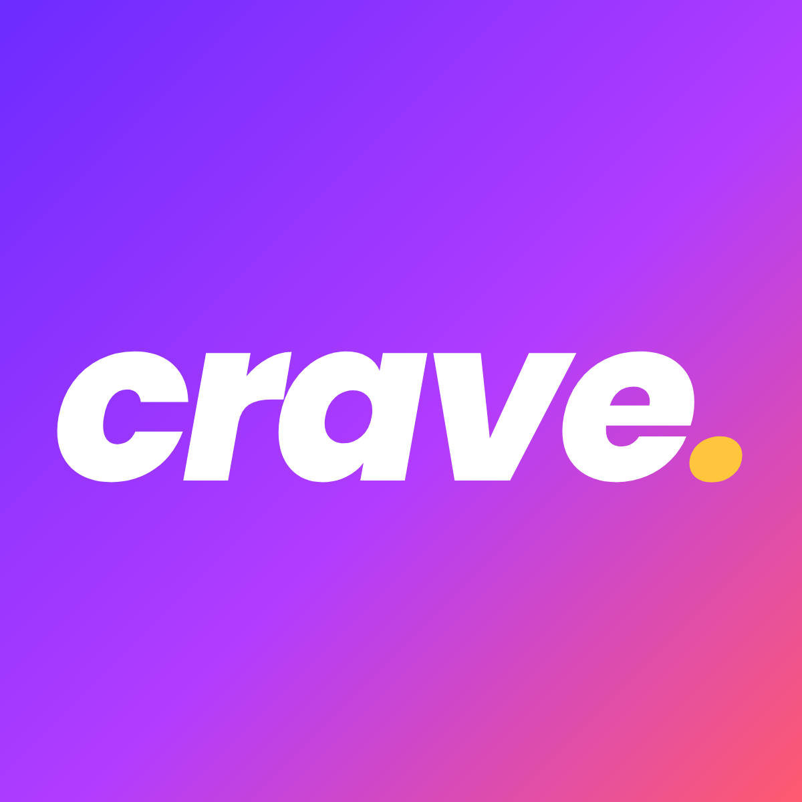

# CRAVE

**Creating Real Authentic Valuable Employees.** A swipe-to-match hiring app for Gen Z job seekers and the employers who want to hire them. iPhone and Android from one codebase.



## What's inside

| Part | Tech | Where |
| --- | --- | --- |
| Mobile app (iOS + Android) | Expo SDK 58, React Native, Expo Router, TypeScript | `src/` |
| Database, auth, file storage, live chat | Supabase (Postgres + Row Level Security + Realtime) | `supabase/migrations/` |
| Resume / LinkedIn PDF import | Supabase Edge Function + Claude API | `supabase/functions/parse-resume` |
| Account deletion (App Store requirement) | Supabase Edge Function | `supabase/functions/delete-account` |
| Employer subscriptions | Apple / Google in-app purchases via RevenueCat | `src/lib/purchases.ts`, `supabase/functions/revenuecat-webhook` |
| Builds and store submission | EAS (Expo Application Services) | `eas.json` |

### Features

- Seeker and employer sign-up (seekers must be 16+, enforced in the database)
- Resume or LinkedIn "Save to PDF" import that auto-fills the profile
- Hinge-style seeker profiles: prompts, photo, 60-second video intro, skills, activities
- Employer profiles for businesses and independent contractors, with culture video, values, perks, licenses, and HR / hiring-manager cards
- Swipe deck for seekers (jobs) and employers (candidates per position); a mutual like creates a match
- "It's a match!" screen, then real-time chat with scam-message warnings, report, block and unmatch
- Hiring map with category-colored pins and filters (verified only, job type, category)
- Verified-employer badge: document upload, staff review, badge can only be set by CRAVE staff
- Employer plans (Solo / Small Business / Pro) with a 30-day free trial enforced server-side
- 16 job categories, each with its own color and icon

## Run it

```bash
npm install
npx expo start          # scan the QR code with the Expo Go app, or press w for web
```

The app connects to the CRAVE Supabase project set in `src/config.ts`. To try it with built-in sample data instead (businesses and jobs around Des Moines, stored on the device), run `EXPO_PUBLIC_DEMO=1 npx expo start`.

Note: maps, video, and payments use native code. Expo Go covers most of it; for the full app use a development build: `npx eas-cli build --profile development`.

## Backend setup (Supabase)

```bash
npx supabase login
npx supabase link --project-ref <your-project-ref>
npx supabase db push                       # creates all tables, rules and storage buckets
npx supabase functions deploy parse-resume
npx supabase functions deploy delete-account
npx supabase functions deploy revenuecat-webhook --no-verify-jwt
npx supabase secrets set ANTHROPIC_API_KEY=... REVENUECAT_WEBHOOK_SECRET=...
```

To approve an employer's verification, set `companies.verification = 'verified'` in the Supabase table editor (requests are in `verification_requests`, documents in the private `verification` bucket). Reports land in `reports`.

## Ship it

```bash
npx eas-cli build --platform all --profile production
npx eas-cli submit --platform ios
npx eas-cli submit --platform android
```

The step-by-step, non-technical version (accounts to create, what to put in the App Store listing, costs) is in `docs/LAUNCH_GUIDE.md`.

## Before launch checklist

- [ ] Replace `REPLACE_WITH_GOOGLE_MAPS_ANDROID_KEY` in `app.json` (Android maps)
- [ ] Change `com.craveapp.crave` in `app.json` if you want a different bundle ID (must be unique on the stores)
- [ ] Publish a Privacy Policy and Terms page and link them in the store listings
- [ ] Create the subscription products `crave_solo_monthly`, `crave_small_monthly`, `crave_pro_monthly` and set final prices (`src/lib/plans.ts`)
- [ ] Set Supabase Auth "Site URL" and email templates; turn on email confirmation

## Project layout

```
src/app/            screens (file-based routing)
  (tabs)/           Discover, Map, Positions, Matches, Profile
  onboarding/       seeker and employer setup
  chat/[id].tsx     real-time chat
  employer/         post a position, verification, plans
src/components/     UI kit, swipe deck, cards, map, video
src/lib/            data layer (api.ts → Supabase or demo), session, purchases
supabase/           database migration and edge functions
```
